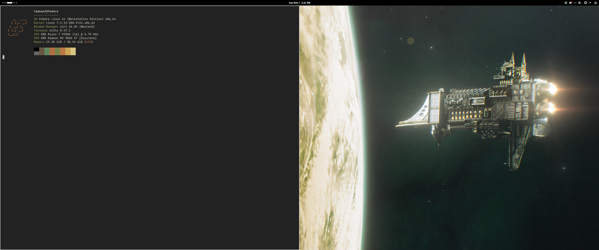
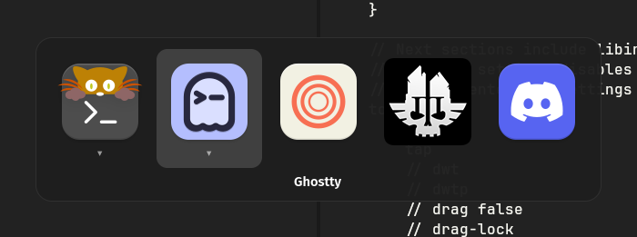
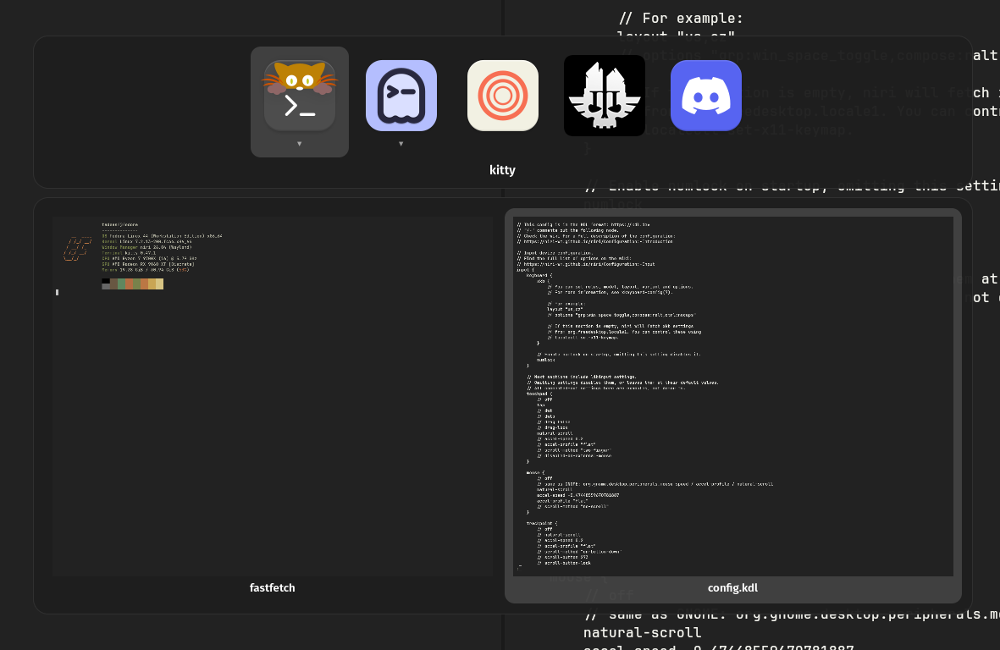
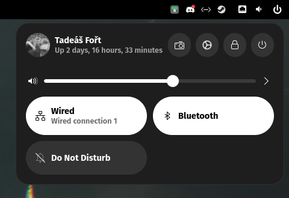
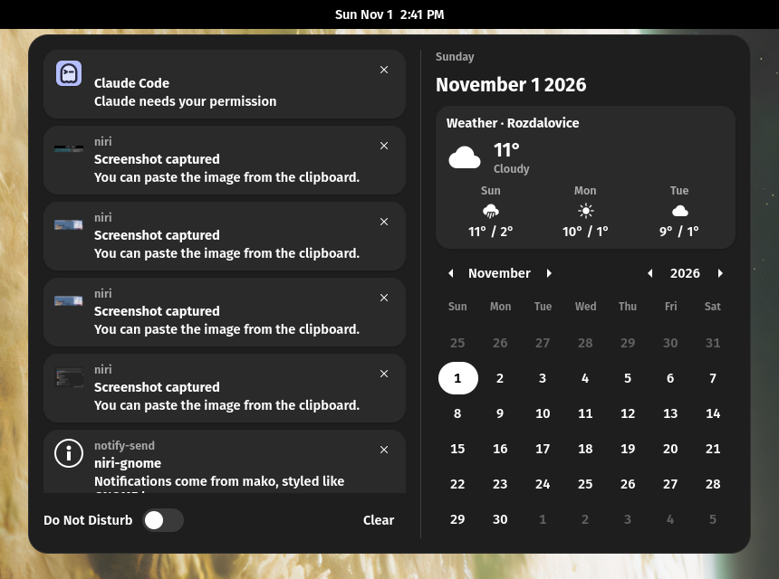
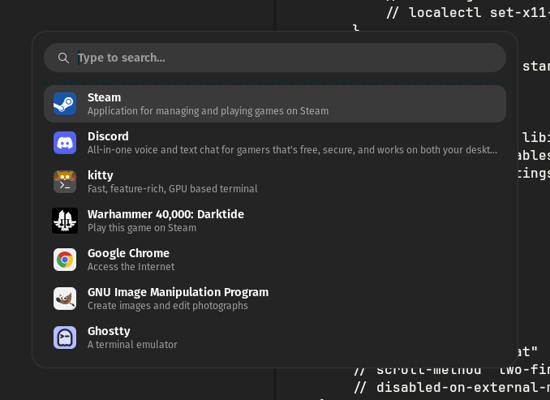
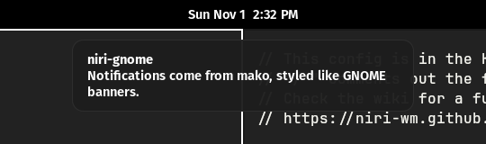
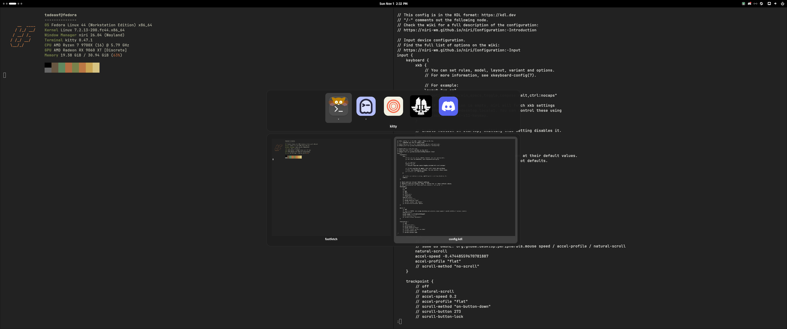

# niri-gnome

A [niri](https://github.com/YaLTeR/niri) desktop that feels like a clean GNOME setup: black and white,
no accent colours, Fira Sans everywhere, a GNOME-style top bar, an ArcMenu-style launcher, GNOME-style
notifications, a **GNOME-style Alt+Tab with app icons, grouped windows and live window previews**, and
GNOME-style quick settings and notification/weather menus in the top bar.

It runs as its own login session next to GNOME and never touches GNOME's settings, so you can switch
between the two at the login screen.




| Alt+Tab: one icon per app | Down: live previews of that app's windows |
|---|---|
|  |  |

| Quick settings (click ⏻) | Notifications + weather (click the clock) |
|---|---|
|  |  |

| Launcher (Super+D) | Notification banner |
|---|---|
|  |  |



## What's inside

| Piece | File | Job |
|---|---|---|
| niri | `config/niri/config.kdl` | the compositor: layout, borders, input, binds, autostart |
| niri-switcher | `config/niri/switcher/niri-switcher.py` | GNOME-style Alt+Tab with window previews |
| waybar | `config/niri/waybar/config.jsonc`, `style.css`, `stats.py` | the GNOME-style top bar with live network/CPU/RAM/GPU stats |
| rofi | `config/niri/rofi/arcmenu.rasi` | app launcher that looks like ArcMenu's "Runner" layout |
| niri-panels | `config/niri/panels/niri-panels.py` | quick settings menu and notifications/weather menu |
| mako | `config/mako/config` | notification banners styled like GNOME's |
| autostart overrides | `config/autostart/picom.desktop`, `nm-applet.desktop` | keep picom and the redundant nm-applet tray icon out of niri (GNOME unaffected) |

Everything in `config/` mirrors `~/.config/`. `install.sh` symlinks each file into place.

## How it works

### niri

- **Wallpaper:** `swaybg` starts with whatever wallpaper GNOME uses, read from
  `gsettings get org.gnome.desktop.background picture-uri-dark` at login. Change it in GNOME and niri
  follows on the next login. `layout { background-color "transparent" }` lets it show through on every
  workspace. On a machine without GNOME, replace that line with `swaybg -i /path/to/image`.
- **No gaps, thin borders:** `gaps 0` gives every pixel to windows. The focused window gets a 2px white
  `border` and the others get a near-black one. A border instead of niri's `focus-ring`, because the ring
  is drawn outside the window and the neighbouring windows cover it when there are no gaps.
- **Mouse:** copied from GNOME (`accel-profile "flat"`, the same `accel-speed`, natural scrolling), so
  the pointer moves the same in both sessions.
- **Workspaces:** four fixed, named workspaces, like a fixed-workspace GNOME setup.
- **Polkit:** under GNOME, GNOME Shell shows password prompts. niri doesn't, so the config starts
  `mate-polkit`'s agent. Without one, `pkexec` and "enter your password" dialogs never appear.

### niri-switcher (Alt+Tab)

niri ships its own Alt+Tab, but it shows a big preview of every window and doesn't group them by app.
This is a small GTK4 app that behaves like GNOME's switcher instead.

- **It runs as a background daemon** (started by niri at login) and shows a centred overlay using
  gtk4-layer-shell. niri's binds poke it over D-Bus with `gdbus`, which is a lot faster than starting
  Python on every key press:
  `gdbus call --session --dest io.github.tadeasf.NiriSwitcher --object-path /io/github/tadeasf/NiriSwitcher --method org.gtk.Actions.Activate next "[]" "{}"`
  (actions: `next`, `prev`, `window`, `prev-window`).
- **Grouping and order:** it asks niri for the window list over niri's IPC socket, groups windows by
  `app_id`, and sorts apps and windows by niri's `focus_timestamp`, so the most recently used app is first.
  Icons come from the apps' `.desktop` files. Steam games (`steam_app_<id>`) use Steam's `steam_icon_<id>`.
- **Releasing Alt (or Super) switches.** A quick tap switches straight to the previous app without the
  popup ever appearing: it stays invisible for the first 120 ms, like GNOME.
- **Window previews** use the same screen-cast D-Bus API (`org.gnome.Mutter.ScreenCast`) that niri
  provides for the screen-sharing portal. For each window of the selected app, the switcher starts a cast
  of that one window, grabs a single frame with GStreamer (`pipewiresrc` → `glupload ! gldownload`,
  because niri only hands out GPU buffers) and saves a small PNG. This works for windows on other
  workspaces or scrolled off screen, and it never touches the clipboard. Previews show up about half a
  second after you press Down; the app icon fills the slot until then.
- **niri's binds are paused while it's open.** The switcher uses the keyboard-shortcuts-inhibit protocol
  (the one VMs and remote desktops use), so Super+arrows move through the switcher instead of moving
  windows. It handles Tab and \` itself while open. Super+Escape (lock) is marked as unpausable in niri,
  so cancel with Alt+Tab → Escape, not Super+Tab → Escape.

| Keys | Action |
|---|---|
| Alt+Tab / Super+Tab | next app (add Shift to go back) |
| Alt+\` | windows of the current app |
| Down | show previews of the selected app's windows |
| Left / Right | move between apps, or between windows when previews are open |
| Up | back from previews to apps |
| release Alt / Super, Enter, click | switch |
| Escape | cancel |

niri's built-in preview switcher is still there on Super+\`.

Debug tip: `NIRI_SWITCHER_HOLD=1 ~/.config/niri/switcher/niri-switcher.py` (after stopping the running one)
keeps the popup open without holding Alt, which is how the screenshots were taken.

### waybar

Workspace dots on the left, the clock in the middle, and on the right the tray, live stats and one power button.
It's a separate config under `~/.config/niri/waybar/`, so an existing `~/.config/waybar` (for another
desktop) isn't touched.

- The clock is a `custom/clock` that runs `date '+%a %b %-d  %-I:%M %p'`, because waybar's own clock module
  rejects `%-d`/`%-I` and renders nothing.
- The workspace dots are buttons with their label hidden (`font-size: 0`). Otherwise the label's font height
  stretches the bar.
- Clicking the clock opens the notifications/weather menu. The power button opens quick settings (see below),
  which also has the volume slider.
- The stats are one small script, `stats.py`, that waybar keeps running. Every 2 seconds it prints the
  connection name (Wi-Fi network or "Wired"), download/upload speed of the default-route interface, CPU,
  RAM and GPU usage (AMD via `gpu_busy_percent` in sysfs, NVIDIA via `nvidia-smi`, hidden if neither).
  Labels are dimmed and numbers are padded with figure spaces and drawn with tabular digits, so the bar
  doesn't jiggle as values change. Click it to open Resources (or GNOME System Monitor); hover for details.

### Quick settings and notifications menus (niri-panels)

The same kind of background daemon as the switcher, holding two GNOME-style menus that waybar toggles over
D-Bus (`... org.gtk.Actions.Activate quick` or `calendar`). Each one is a transparent full-screen layer
under the bar with the menu in it, so clicking anywhere outside it (or pressing Escape) closes it, just
like GNOME.

**Quick settings** (inspired by GNOME's menu and DankMaterialShell's control center):

- your avatar (`~/.face` or the GNOME account picture) and name, with uptime
- screenshot, Settings (`gnome-control-center`), lock (`swaylock`) and a power button that unfolds
  Suspend, Restart, Power Off and Log Out
- a volume slider (`wpctl`), mute on the speaker icon, `pavucontrol` behind the arrow; a brightness slider
  appears on laptops (`brightnessctl`)
- toggles: Wi-Fi (`nmcli radio`) or Wired (opens the connection editor), Bluetooth (`bluetoothctl`),
  Do Not Disturb (mako's `do-not-disturb` mode) and Power Mode if `power-profiles-daemon` is installed

**Notifications and weather:**

- every notification mako still shows or has in its history (`makoctl list`/`history`, kept for the last 50),
  newest first, each with a close button, plus "Clear" and a Do Not Disturb switch at the bottom.
  mako can't delete history, so cleared ones are remembered in `~/.local/state/niri-panels.json`.
- weather from [wttr.in](https://wttr.in): now and the next three days, refreshed every 15 minutes.
  It finds your location from your IP. To pin a city, write it into
  `~/.config/niri/panels/weather-location` (for example `Prague`).
- the date and a calendar.

### rofi launcher

Super+D or Alt+F2. A copy of ArcMenu's "Runner" layout: 600px wide, a pill-shaped search field with a
magnifier icon, each app with its description underneath, most-used apps first. Search matches names,
descriptions and keywords, so "terminal" or "games" work. Notes:

- The search icon is an `icon-search` widget with `system-search-symbolic`, not a Nerd Font glyph (glyphs
  rendered as stray characters).
- Every text element has an explicit `text-color`, including the search entry. Leave one out and rofi
  falls back to its default blue or unreadable colours.

### mako

Dark grey rounded banners at the top centre with Fira Sans, matching GNOME's. mako runs only in niri
(GNOME has its own notifications). It keeps 50 notifications of history for the notifications menu and has a
`do-not-disturb` mode that hides banners.

## Install

Tested on Fedora 44 with niri 26.04. `--deps` also knows the package names for Arch (pacman), openSUSE
(zypper) and Debian/Ubuntu (apt). Debian/Ubuntu don't package niri, Fira Sans or a Nerd Font, so install those
yourself; on any other distro, install the same things under your distro's names (the lists are in `install.sh`).

```bash
git clone https://github.com/tadeasf/niri-gnome.git ~/niri-gnome
cd ~/niri-gnome
./install.sh --deps   # installs packages (dnf/pacman/zypper/apt), then links the configs
```

Without `--deps`, it only links the configs. Any file it replaces is kept next to it as
`<file>.bak-<timestamp>`. Then log out and choose **Niri** on the GDM login screen.

You'll also want:

- **Fonts:** Fira Sans (`mozilla-fira-sans-fonts`) for the UI, and any Nerd Font for the bar icons. The
  waybar config tries "CaskaydiaCove Nerd Font", then "Cascadia Code NF" (`cascadia-code-nf-fonts`),
  then "Symbols Nerd Font".
- **The switcher and the menus need the system Python**: the scripts run `/usr/bin/python3` because it needs PyGObject
  (`python3-gobject`). A Python from pyenv/mise/uv won't have it.

### Things to change for your machine

These are personal choices in `config/niri/config.kdl`. Edit them to taste:

- `output "HDMI-A-2"` / `output "eDP-1"`: monitor modes and scaling (outputs you don't have are ignored)
- `layout "us,cz"` keyboard layouts, switched with Super+Space
- terminals on Super+Return (ghostty), Super+Ctrl+Return (alacritty), Super+Shift+Return (kitty)
- `Ctrl+Shift+Return` (mpv playlists) and `Super+Shift+O` (CopyQ)
- the cursor theme (`Bibata-Modern-Ice`)

## Keeping your changes (the repo is the live config)

`install.sh` doesn't copy files, it **symlinks** them. `~/.config/niri/config.kdl` and the rest point into
this repo, so whatever you change (in either place) is already a change in git.

- **Save a change:** edit as usual, then `git add -A && git commit -m "..." && git push` in the repo.
- **Apply a change:** niri reloads `config.kdl` the moment you save it. Check it with
  `niri validate -c ~/.config/niri/config.kdl`. waybar and mako need a restart:
  `pkill -x waybar && niri msg action spawn-sh -- "waybar -c ~/.config/niri/waybar/config.jsonc -s ~/.config/niri/waybar/style.css"`,
  and `makoctl reload`.
  For the switcher or the menus: `pkill -f niri-switcher.py; niri msg action spawn-sh -- "~/.config/niri/switcher/niri-switcher.py"`
  (same with `niri-panels.py` under `~/.config/niri/panels/`).
- **Add a new file:** put it under `config/` at the same path it has under `~/.config/`, then run `./install.sh`.
- **Undo:** `git checkout -- <file>` or `git revert`, and niri reloads it straight away.
- **New machine:** clone, `./install.sh --deps`, log in to niri.

## Troubleshooting

- **No password prompts:** the polkit agent isn't running. Check the path in `spawn-at-startup`.
- **Alt+Tab does nothing:** check that the daemon is running (`pgrep -af niri-switcher`) and start it by
  hand to see errors. `ModuleNotFoundError: gi` means it ran with the wrong Python.
- **Previews stay as icons:** check that `gst-inspect-1.0 pipewiresrc` and `gst-inspect-1.0 glupload` work
  (`pipewire-gstreamer`, `gstreamer1-plugins-base`).
- **Empty clock in waybar:** you're on the stock clock module with `%-` specifiers. Keep `custom/clock`.
- **Joining a new Wi-Fi network:** nm-applet is hidden in niri (the bar shows the network), and it's also
  what asks for Wi-Fi passwords. Use `nmcli device wifi connect <SSID> --ask` or `nm-connection-editor`,
  or delete `~/.config/autostart/nm-applet.desktop` to bring the tray icon back.
- **picom errors at login:** something autostarts picom (an X11 compositor). The override in
  `config/autostart/picom.desktop` hides it in niri only.

## License

MIT
